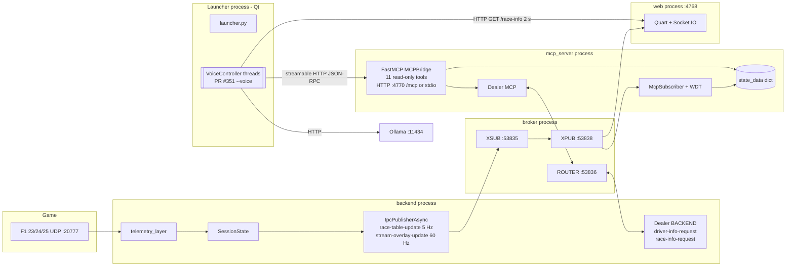
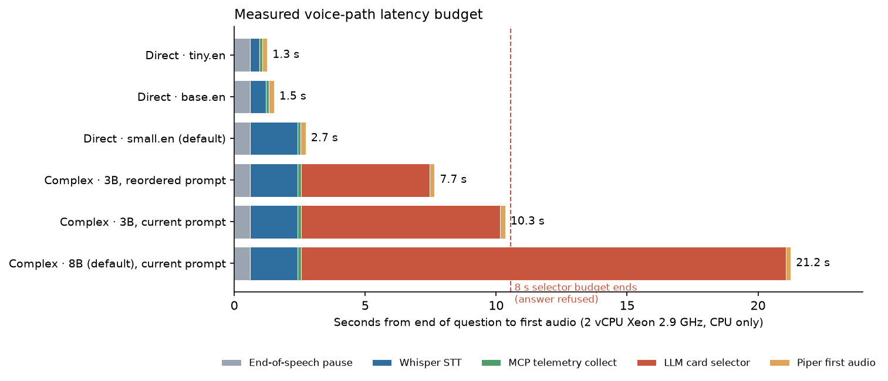

# Pits n' Giggles MCP and Voice Architecture Audit

Audit date: 19 November 2026
Scope: [kmransom56/pits-n-giggles](https://github.com/kmransom56/pits-n-giggles) at `main` 3490db9 (v4.4.2), `feat/voice-assistant` d856557 ([PR #351](https://github.com/ashwin-nat/pits-n-giggles/pull/351)), `feat/voice-assistant-v5` 0a6fcde, and `release-v5.0.0` d3d58a2. The `kmransom56/pitsngiggles-mcp-integration` repository returns HTTP 404 on GitHub and is not in your repository listing, so it is no longer reachable from this account (deleted, renamed, or moved to Gitea). Its role is covered from the voice code that now lives in the fork (`apps/voice`) and from your earlier project notes (Piper/Whisper sidecar, port 8765 Node bridge, Windows `Start-RaceEngineer.ps1` with `llama-server` on port 8080).

---

## 1. Executive summary

| # | Finding | Severity | Evidence |
|---|---|---|---|
| F1 | The voice telemetry adapter fails its cross-tool coherence check when the race table updates mid-collection. Tyre/fuel/pit answers succeed 91–98% at the default 5 Hz, 55–70% at 10 Hz and **0% at 20 Hz**. | High | Benchmark §6.3 |
| F2 | The default complex-question model (`llama3.1:8b`) takes **18.5 s warm** per selector call on 2 vCPU, against a hard 8 s budget, so complex questions always fall back to "Insufficient verified data." | High | §6.5 |
| F3 | The selector prompt puts changing timestamps ahead of the static knowledge cards, which defeats Ollama's prompt-prefix cache. Moving static content first cuts warm latency by **35%** (8B: 18.5 → 11.9 s; 3B: 7.6 → 4.9 s). | Medium (easy win) | §6.5 |
| F4 | On Windows, Piper never plays audio. `tts.py` only pipes PCM into `pw-play` or `paplay` (PipeWire/PulseAudio), so it drops to `pyttsx3` (SAPI). `select_headset_mic` uses `pactl` and does nothing on Windows. | High for your Windows target | `apps/voice/tts.py`, `voice_controller.py` |
| F5 | The branch hard-codes Ollama `/api/generate` on port 11434. Your Windows runtime uses `llama-server` (OpenAI-compatible) on port 8080. | Medium | `engineer.py` DEFAULT_CONFIG |
| F6 | Voice runs as threads inside the Qt launcher process rather than as a managed subsystem: no heartbeat, stats, crash isolation or restart. `launcher.py` imports `VoiceController` at module load even when `--voice` is off. | Medium | launcher diff |
| F7 | MCP event-loop lag is p99 ≈ 135 ms, max ≈ 380 ms, under tool load. Tool handlers run synchronous JSON shaping and output-schema validation on the same loop as the IPC subscriber. | Medium | §6.2 |
| F8 | PR #351 CI is red because `poetry.lock` is stale (unit tests) and the runner image lacks Python 3.13.3 (lint). The code itself is fine: all **277 voice unit tests pass** locally. | Low | CI logs, local pytest |
| F9 | Cloud and optional dependencies (`google-genai`, `edge-tts`, `PyAudio`, `pyttsx3`, `faster-whisper`, `piper-tts`) are added to base `dependencies`, which makes every install and PyInstaller bundle bigger. | Low | `pyproject.toml` |

---

## 2. System topology

The application is a set of launcher-managed processes connected by a ZeroMQ fabric. MCP is one of those processes. It is a read-only projection of the backend's state, not a router in its own right.



Process lifecycle: `apps/launcher/subsystems/mcp_mgr.py` spawns `python -m apps.mcp_server --managed` only when `MCP.mcp_http_server_enable` is true. That setting **defaults to false**, so voice needs it enabled. In managed mode the transport is HTTP. Run unmanaged (for example by Claude Desktop), it uses stdio.

---

## 3. How MCP routes messages

### 3.1 Three routing planes

| Plane | Mechanism | Code | Direction | Used by MCP for |
|---|---|---|---|---|
| Pub/sub telemetry | ZMQ XSUB/XPUB broker, 3-frame envelope `[topic, meta, payload]` | `lib/ipc/pubsub/*`, `apps/broker/png_broker.py` | Backend → all | `race-table-update` cached into `state_data` |
| Request/reply between apps | ZMQ ROUTER with identity-addressed DEALERs | `lib/ipc/router_dealer/*` | MCP ↔ Backend | `driver-info-request` for lap history, race-control events, car damage |
| Management | Per-child REQ/REP `IpcServerAsync` | `apps/mcp_server/mgmt.py` | Launcher → MCP | shutdown, heartbeat, get-stats |

### 3.2 Tool dispatch path

1. **Transport ingress.** `MCPBridge.run()` binds the socket itself (`SO_EXCLUSIVEADDRUSE` on Windows), takes `mcp.http_app()`, and serves it with its own `uvicorn.Server` inside `mcp._lifespan_manager()`. In stdio mode it calls `mcp.run_async(transport="stdio")`.
2. **JSON-RPC routing.** FastMCP decodes `tools/call`, applies `strict_input_validation=True` (for example, `driver_index` must be between 0 and 21), and looks up the tool by name.
3. **Instrumentation.** `_tool()` wraps every handler and records per-tool call counts and latency in `EventCounter`. These are exposed through the management `get-stats` command.
4. **Handlers come in two kinds:**
   - **Cache-read tools** (`get_session_info`, `get_race_table`, `get_drivers_list`, `get_player_*`, `get_tyre_wear`, `get_fuel_info`). These are synchronous functions that read `state_data["race-table-update"]`, reshape it, and return `available`, `connected` and `last-update-timestamp`. They make no IPC round trip.
   - **Pull tools** (`get_driver_lap_times`, `get_session_events_for_driver`, `get_car_damage`). These call `fetch_driver_info()` → `dealer.request("BACKEND", "driver-info-request", {index})`. A correlation ID and future are created. The send lock is held only for `send_multipart`, not while waiting for the reply (the sequence diagram in `SEQUENCE_DIAGRAM.mmd` suggests otherwise, but the code is correct). The router swaps identity frames, and the backend handler `handleDriverInfoRequest` replies. The recv loop then matches the 3-frame reply to the future. Timeout is `ACK_TIMEOUT = 2.0 s`, and errors are returned as `status.ok=false` rather than raised.
5. **Output.** FastMCP validates the result against `output_schema` and returns `structured_content` plus a text block.

### 3.3 Freshness semantics

`state.py` stamps each cached topic with `time.time()` **at subscriber receipt**. This is IPC-receipt time, not game-packet time. The voice adapter correctly treats it that way: `telemetry.py` notes that "recent cache receipt is NOT game-packet age". `connected` comes from a 10 s watchdog that is kicked on every `race-table-update`.

### 3.4 Routing-level observations

- `IpcSubscriberAsync.run()` calls `await asyncio.to_thread(poller.poll, 100)` on every iteration. That is one thread-pool hop per message or per 100 ms idle tick, followed by a synchronous `recv_multipart` on the loop thread. It works, but a native `zmq.asyncio` socket would remove the hop and the thread-pool contention with uvicorn.
- On Windows, `asyncio.WindowsSelectorEventLoopPolicy()` is required for pyzmq asyncio. Anything voice-related that shares the loop must not assume Proactor features such as subprocess pipes.
- Client disconnects log `anyio.ClosedResourceError` from the streamable-HTTP standalone SSE writer. This is harmless but noisy in logs.

---

## 4. Voice synthesis: where the hooks are and where they should go

### 4.1 Current pipeline (PR #351)

```
Mic → speech_recognition.listen (pause 0.6 s) → WhisperSTT (faster-whisper int8 CPU)
    → wake-word regex → RadioQueue (priority, TTL, quota 4/3/1)
    → VoiceWork thread → LocalEngineer (own asyncio loop thread)
        ├─ classify() → TelemetryAdapter.collect() over MCP HTTP (sequential tool calls)
        ├─ direct topics → answer_direct() (no LLM)
        └─ complex → build_context() → Ollama /api/generate (num_predict 8) → reviewed card id
    → revalidate_answer() → Speaker.say() (Piper → pw-play/paplay; fallback pyttsx3)
Side producers: TelemetryWatcher (own thread + loop, MCP poll 1–5 s), RaceControlAnnouncer (thread, HTTP /race-info every 2 s)
```

Thread and loop inventory for one `--voice` launch: VoiceListen, VoiceWork, LocalEngineerLoop (asyncio), TelemetryWatcher (asyncio.run on its own thread), RaceControlAnnouncer. That is three separate event loops and three MCP or HTTP client sessions, all inside the Qt launcher process.

### 4.2 Recommended insertion points

| Hook | Where | Why |
|---|---|---|
| **H1 – TTS backend interface** | Replace `Speaker._say_piper`'s hard-coded `pw-play`/`paplay` with an `AudioSink` protocol: `PipeWireSink`, `PulseSink`, `SoundDeviceSink` (PortAudio/WASAPI for Windows), and `NullSink` for tests. | Fixes F4. Piper already yields `audio_int16_bytes` per sentence, so a `sounddevice.RawOutputStream` can stream it directly with no subprocess. |
| **H2 – Sentence-level streaming** | In `VoiceController._deliver`, call the TTS per sentence as soon as each one is available. `ask_stream` already yields `Answer` objects, so make direct answers yield one per sentence. | Piper's first chunk takes 34–190 ms, but whole-answer synthesis grows linearly (0.8 s for a 228-character answer). Streaming caps time-to-first-audio at about one sentence. |
| **H3 – Pre-rendered acks** | Cache the PCM for "Go ahead.", "Radio check. Engineer ready.", "Radio busy…" at start-up. | Removes 47 ms or more from the most latency-sensitive replies. |
| **H4 – Event-driven callouts** | Have the voice subsystem subscribe to the existing pub/sub topic `race-table-update` instead of `TelemetryWatcher` polling MCP. Race-control events can come from the backend over the dealer (`race-info-request`) instead of HTTP GET to the web process. | Removes two polling loops and the dependency on the web process, and gives one coherent snapshot per message (see F1). |
| **H5 – Barge-in and ducking** | Expose `Speaker.cancel()`, which closes the sink stream between chunks, and call it from `submit_question` when a new wake word arrives. | Today `say()` cannot be pre-empted and the mic is fully muted while speaking (`speaker.speaking`). |
| **H6 – Launcher subsystem** | On v5, implement `apps/voice` as an `AsyncSubsystem` (from `lib/subsystem`) with a `VoiceMgr` in `apps/launcher/subsystems/`, mirroring `mcp_mgr.py`. Gate it on a config flag, not a CLI flag. | Fixes F6: heartbeat, stats, restart, isolation from the Qt GUI, and lazy imports. |
| **H7 – LLM backend interface** | Abstract `_select_card` behind `SelectorBackend` with `OllamaGenerate` and `OpenAIChat` (`llama-server` `/v1/chat/completions`) implementations. | Fixes F5. Lets Windows reuse `Start-RaceEngineer.ps1`'s port 8080 server. |
| **H8 – MCP composite tool** | Add `get_player_radio_snapshot` to `MCPBridge`. It would return session, standings row, tyres and fuel built from **one** `get_state_data("race-table-update")` read. | Fixes F1 for external MCP clients too, and turns 3–5 sequential HTTP calls into one. |

H8 sketch:

```python
@self._tool(name="get_player_radio_snapshot", output_schema=RADIO_SNAPSHOT_SCHEMA,
            annotations=ToolAnnotations(readOnlyHint=True, openWorldHint=False))
async def get_player_radio_snapshot_tool():
    entry = get_state_data("race-table-update")          # single atomic read
    return build_radio_snapshot(entry, get_state_data("connected"))  # session+row+tyre+fuel
```

`TelemetryAdapter.collect()` would then make one `_call` and drop the before/after `get_session_info` bracketing for these topics. Coherence holds by construction.

---

## 5. Asynchronous event-loop considerations

1. **Shared MCP loop.** The subscriber, dealer recv loop, watchdog, management server, uvicorn and all tool handlers share one loop. Measured loop lag (10 ms sleep-drift probe): p50 0.3 ms, p95 22 ms, **p99 137 ms, max 380 ms** while the benchmark called tools. A 380 ms stall is longer than one 200 ms race-table period, so a telemetry message can wait behind a tool call. Mitigations:
   - Precompute the shaped `get_race_table` and player views once per `race-table-update` in the subscriber, and memoise them by `(session-uid, ts)`. Tool calls then return cached dicts.
   - Or offload the shaping with `asyncio.to_thread`. Shaping a 38 KB payload is small; the measured cost is mostly FastMCP and pydantic validation.
   - Consider turning off `output_schema` validation in production for the large race table (this is a FastMCP configuration choice).
2. **Dealer concurrency.** `request()` is correctly concurrent: one future per correlation ID, with the lock held only around the send. Throughput tops out at about 37 requests/s at 8 concurrent clients (latency p50 213 ms), and the limit is MCP CPU, not the router. The 2 s timeout is longer than the voice adapter's 1 s per-tool budget, so a slow backend shows up to voice as `TimeoutError` while MCP itself would still be waiting.
3. **Voice threading model.** `LocalEngineer` runs a private loop on a thread and bridges with `run_coroutine_threadsafe` plus `future.result(timeout)`. That is correct, but it adds three loops and three MCP sessions to the launcher process. In an `AsyncSubsystem` there would be one loop. Blocking work then goes to explicit executors: Whisper (`to_thread`; CTranslate2 releases the GIL), Piper (`to_thread`; onnxruntime releases the GIL), and audio output via a callback stream.
4. **Cancellation.** `reset_session()` and `cancel_request()` are non-blocking and generation-guarded, which is well designed. The gap is that `Speaker.say()` and `WhisperSTT.transcribe()` cannot be interrupted. STT runs on the listening thread, so the mic is deaf for 0.35–1.8 s while each phrase is transcribed. Move STT to a worker and keep capturing (ring buffer plus VAD).
5. **Clock domains.** The adapter uses `time.monotonic` for deadlines and epoch time for cache receipts, and checks for clock jumps (good). `_extract_question` uses `time.time()` for the follow-up window. It should use the injected monotonic clock like the rest of the scheduler.
6. **Windows loop policy.** The MCP child sets `WindowsSelectorEventLoopPolicy`. The Selector loop has no subprocess support on Windows, so any future voice code using `asyncio.create_subprocess_exec` for audio players would fail there. This is another reason to stream audio in-process (H1).

---

## 6. Performance benchmarks (local execution)

### 6.1 Method

- **Host:** sandbox with 2 vCPU Intel Xeon @ 2.9 GHz, 7 GB RAM, no GPU, Python 3.12, FastMCP 3.4.11, pyzmq 27.3, faster-whisper 1.2.1, piper-tts 1.3, Ollama 0.40.
- **MCP/IPC harness:** three OS processes running the **real** `IpcPubSubBroker`, `IpcRouter`, `IpcPublisherAsync`, `McpSubscriber`, `IpcDealerAsync` and `MCPBridge` code over streamable HTTP. A synthetic 20-car race table (38 KB) is published at 5, 10 and 20 Hz with session time advancing, and a fake backend dealer answers `driver-info-request`.
- **Voice harness:** Piper `en_GB-alan-medium` (the branch default). Whisper runs closed-loop: Piper speaks each question, the audio is resampled to 16 kHz, and Whisper transcribes it with the branch's exact settings (`int8`, `beam_size=1`, VAD, F1 prompt). Ollama runs the exact `_select_card` payload (`num_predict 8`, `num_ctx 4096`, `temperature 0`).
- **Scaling:** results are a conservative lower bound. On an 8-core desktop, Whisper and LLM prompt evaluation scale roughly with physical cores (expect about 3–4× faster). MCP latency scales with single-core speed.

### 6.2 MCP tool latency (persistent session, n=200, 5 Hz publish)

| Tool | Path | p50 ms | p95 ms | p99 ms | Response bytes |
|---|---|---|---|---|---|
| get_session_events_for_driver | dealer | 13.5 | 17.3 | 24.8 | 93 |
| get_player_fuel_info | cache | 14.9 | 17.4 | 24.3 | 432 |
| get_player_tyre_wear | cache | 16.3 | 19.2 | 23.4 | 443 |
| get_player_driver_info | cache | 16.1 | 20.8 | 25.7 | 410 |
| get_drivers_list | cache | 19.7 | 23.7 | 31.7 | 3,405 |
| get_session_info | cache | 22.0 | 26.8 | 34.5 | 953 |
| get_driver_lap_times | dealer | 22.6 | 25.9 | 34.7 | 3,011 |
| get_car_damage | dealer | 30.7 | 36.0 | 41.7 | 668 |
| get_race_table | cache | 49.6 | 59.9 | 65.4 | 17,930 |

Other measurements:

| Measurement | Result |
|---|---|
| New client session + `list_tools` | p50 19.7 ms, p99 221 ms |
| Voice snapshot (4 tools in parallel) | p50 93 ms, p95 110 ms |
| Voice adapter (3 tools sequential) | p50 89 ms, p95 103 ms |
| `get_race_table` at 1 / 4 / 16 clients | 19.3 / 21.3 / 21.7 rps; p50 50 / 190 / 750 ms (CPU-bound, one loop) |
| `get_car_damage` at 1 / 8 clients | 30.8 / 37.6 rps; p50 31 / 213 ms |
| IPC pub/sub latency (publisher → subscriber, 38 KB) | p50 0.73 ms, p99 0.83 ms; inter-arrival jitter under 5 ms |
| MCP loop lag under load | p50 0.27 ms, p95 22 ms, p99 137 ms, max 379 ms |

Takeaways:

- Transport overhead dominates: even a 93-byte reply costs about 14 ms of HTTP, JSON-RPC and validation, against under 1 ms for IPC.
- `get_race_table` costs about 3× a small tool, roughly in proportion to payload size.
- Results at 20 Hz were within 5% of 5 Hz. Publish rate does not affect tool latency, but it does affect coherence (next section).

### 6.3 Voice telemetry collection: coherence versus publish rate (n=80 per cell)

| Topic (MCP calls) | 5 Hz (default) | 10 Hz | 20 Hz | p50 latency at 5 Hz |
|---|---|---|---|---|
| gaps (3) | 100% | 100% | 100% | 98 ms |
| fuel (4) | 100% | 70% | **0%** | 121 ms |
| tyres (4) | 97.5% | 61% | **0%** | 122 ms |
| pit (5) | 91% | 55% | **0%** | 148 ms |

The failure reason is always `Incoherent session/player cache generation`. `collect()` requires each player tool's `last-update-timestamp` to equal the race table's. A new publish between the sequential calls breaks that, and the single retry hits the same race. The failure rate is roughly the collection window divided by the publish period. This is safe, since it refuses rather than speaking stale data, but it gets worse with anything that raises `local_telemetry_rate` or slows MCP. H8, or a direct pub/sub subscription (H4), fixes it.

### 6.4 Speech

| Component | Model | Load | Latency p50 | Accuracy (4 F1 phrases) |
|---|---|---|---|---|
| STT | tiny.en int8 | 0.8 s | 0.35 s per ~2.5 s clip | 2/4 exact ("tyre **where**", "**wets** the gap") |
| STT | base.en int8 | 0.6 s | 0.61 s | 2/4 exact (same errors) |
| STT | **small.en int8 (default)** | 1.8 s | **1.82 s** | **4/4 exact** |

Piper TTS (`en_GB-alan-medium`), load 0.42 s:

| Utterance | Characters | Audio | First chunk | Full synthesis | Real-time factor |
|---|---|---|---|---|---|
| ack | 9 | 0.9 s | 47 ms | 47 ms | 0.053 |
| short | 53 | 3.7 s | 187 ms | 187 ms | 0.050 |
| medium | 100 | 7.0 s | 87 ms | 306 ms | 0.044 |
| long | 228 | 15.7 s | 34 ms | 805 ms | 0.051 |

`small.en` is the right default for accuracy; tiny and base mishear "wear" and "what's". A cheaper option is to keep `small.en` and add a domain post-correction map (where→wear, wets→what's), or to use `base.en` with that map on slow CPUs. Piper runs at about 20× real time, so the gain from TTS work is in streaming (H2), not raw speed.

### 6.5 Local LLM selector (complex-question path, budget 8 s)

| Model | Cold first call | Warm, identical prompt | **Warm, realistic (evidence changes), current order** | Warm, realistic, static prefix first | Generation speed | Free-form "pit for inters?" |
|---|---|---|---|---|---|---|
| qwen2.5:1.5b | 8.0 s | 0.37 s | — | — | 16–19 tok/s | Wrong ("should pit") |
| llama3.2:3b | 15.9 s | 0.66 s | **7.6 s** | **4.9 s** | 7–9.5 tok/s | Correct |
| llama3.1:8b (default) | 34.4 s | 1.5 s | **18.5 s** | **11.9 s** | 3.7–4.3 tok/s | Correct |

All models chose the correct card (`wet-crossover`). Benchmarks that repeat the same prompt look fine (0.4–1.5 s) only because Ollama reuses the KV cache. In use, `build_context()` serialises `question` and then `evidence`, which includes the `expires_mono` and `stamps` values that change every request, ahead of the static cards. Most of the prompt is therefore re-evaluated every time.

Recommendations:

1. Reorder the payload to `_INSTRUCTIONS + cards + eligible_ids + limitations`, then `question + evidence`. Strip mono timestamps from the model input; the controller still revalidates them after inference.
2. On CPU-only machines, default to `llama3.2:3b` (fits the 8 s budget at 4.9 s on 2 vCPU). Keep 8B for machines with 8 or more cores or a GPU.
3. Warm the model at start-up (`keep_alive` is already `2h`), so the 16–34 s cold load happens before the race and not on the first question.
4. Selection is a closed-set classification. A constrained grammar or JSON enum (`format` in Ollama, or a `grammar` in llama-server) would let `num_predict` drop to the card ID length.

### 6.6 End-to-end time to first audio



Measured components on 2 vCPU:

| Path | Pause | STT | Collect | LLM | First audio | Total |
|---|---|---|---|---|---|---|
| Direct, small.en | 0.6 | 1.82 | 0.12 | — | 0.19 | **2.7 s** |
| Direct, base.en | 0.6 | 0.61 | 0.12 | — | 0.19 | 1.5 s |
| Complex, 3B, reordered | 0.6 | 1.82 | 0.14 | 4.9 | 0.19 | 7.7 s |
| Complex, 8B, current | 0.6 | 1.82 | 0.14 | 18.5 → budget exceeded | — | refusal at about 10.6 s |

### 6.7 Tests and CI

- Running `pytest tests/tests_voice_*.py -n 2` locally gives **277 passed** in 3.3 s.
- In PR #351 CI, the unit-test jobs fail at `poetry install` with "pyproject.toml changed significantly since poetry.lock was last generated". `feat/voice-assistant-v5` already contains the lock refresh (0a6fcde).
- The lint jobs fail because the runner image (Ubuntu 26.04) does not offer Python 3.13.3. That is infrastructure, not code.

---

## 7. Prioritised remediation plan

| Priority | Change | Fixes | Acceptance check |
|---|---|---|---|
| P0 | Rebase PR #351 on the v5 branch or refresh `poetry.lock`; move voice dependencies to `[project.optional-dependencies].voice`; lazy-import `VoiceController` | F8, F9, part of F6 | CI green; `pip install .` pulls no audio or ML wheels |
| P0 | Add the `get_player_radio_snapshot` composite tool (H8) and switch `TelemetryAdapter` to it | F1 | ≥ 99.5% success for tyres/fuel/pit at 5, 10 and 20 Hz with the harness in `bench/` |
| P0 | `AudioSink` abstraction with a `sounddevice` WASAPI sink (H1) | F4 | Piper audible on Windows 11; `pyttsx3` used only as last resort |
| P1 | Reorder the selector prompt, default to 3B on CPU, warm at start-up | F2, F3 | Warm realistic selector p95 < 6 s on the target PC |
| P1 | `SelectorBackend` with an OpenAI-compatible `llama-server` option (H7) | F5 | `Start-RaceEngineer.ps1` port 8080 works with no Ollama installed |
| P1 | Voice as a v5 `AsyncSubsystem` plus `VoiceMgr`; pub/sub-driven watcher (H4, H6) | F6 | Launcher stats show a VOICE subsystem; killing it does not affect the HUD or web |
| P2 | Precompute or cache MCP views per publish; optionally relax output validation | F7 | MCP loop-lag p99 < 30 ms under 16-client load |
| P2 | Sentence streaming, pre-rendered acks, barge-in, STT off the capture thread (H2, H3, H5) | UX | Time to first audio ≤ 1.0 s after STT on direct answers; wake word interrupts speech |

---

## 8. Reproducing the benchmarks

The harness is in [`scripts/bench_mcp_voice/`](../../scripts/bench_mcp_voice/):

- `bench_mcp.py`: real IPC and MCP processes. Set `RATE_HZ` for the publish rate; `VOICE_ONLY=1` runs only the coherence test.
- `bench_voice.py`: Piper, Whisper closed loop, and Ollama models.
- `bench_prefix.py`: prompt-order cache experiment.
- `chart.py`: regenerates `voice_latency_budget.png`.
- `results/*.json`: the raw output behind every table above.

See the harness README for setup. A re-run on the target Windows PC gives figures for that hardware in place of the 2-vCPU numbers in this report.
